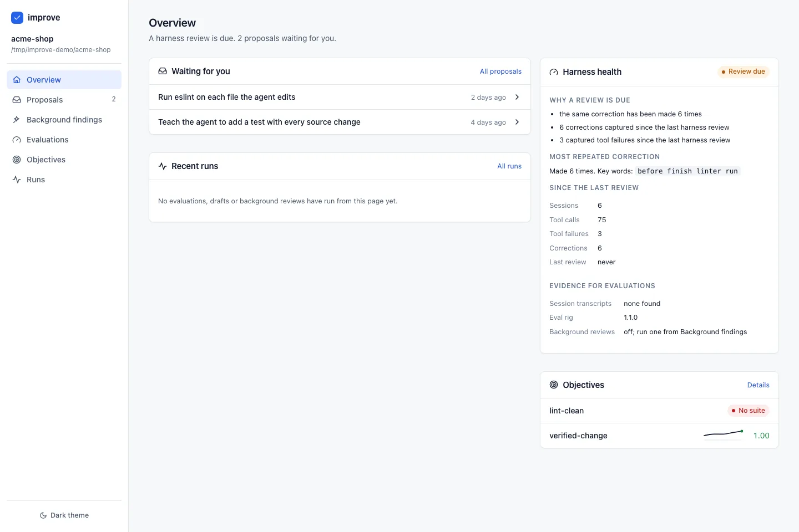
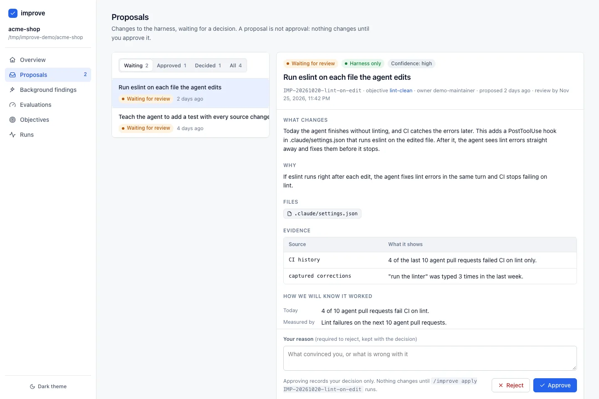
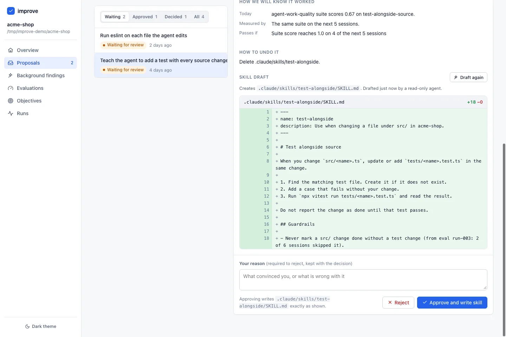
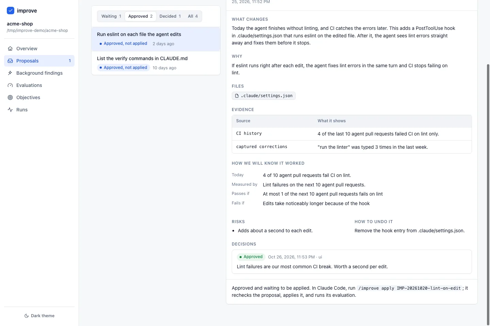
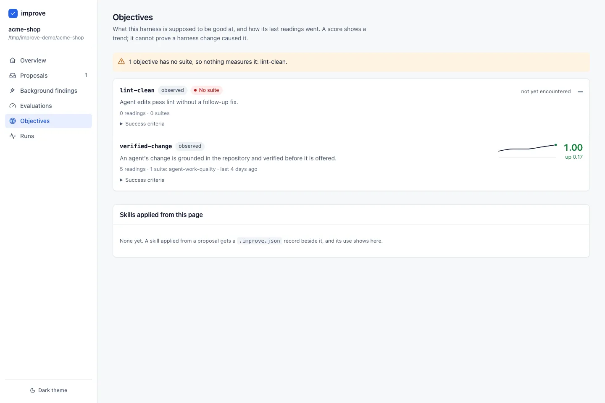

# Improve

**Make Claude Code better at working in your repository, one approved change at a time.**

Improve watches how Claude Code works in your repository. It notices what keeps
going wrong, such as the same correction typed again and again, failing tools,
or work finished without a test. It then suggests a small fix to how the agent
is set up, with the evidence behind it. You read each suggestion, approve or
reject it, and Improve applies only what you approved.



## What it does for you

- **Notices patterns you would miss.** It keeps a light record of each session:
  corrections you make, tools that fail, and how much work was done. It never
  keeps your code.
- **Tells you when a review is due.** When the same problem repeats, Claude
  mentions at the start of a session that a review is worth doing.
- **Suggests small, specific fixes.** Each suggestion says what changes today,
  which file it touches, why, and how you will know it worked.
- **Waits for you.** Nothing changes until you approve it. You can undo
  every change.
- **Tracks whether it helped.** Scores for the things you care about are kept
  over time, so you can see the trend.

Improve changes the setup around the agent: its instructions (`CLAUDE.md`),
skills, hooks and settings. It does not change your application code. When it
finds a bug in your code, it tells you, and suggests the setup change that would
have caught it.

## How to use it

### 1. Install the plugin

In Claude Code:

```text
/plugin marketplace add chrisjowen/improve
/plugin install improve@improve-marketplace
```

If Claude Code asks you to restart or reload plugins, do so.

### 2. Set up your repository

Open Claude Code in your repository and run:

```text
/improve init
```

Claude looks around your repository and asks a few questions about what good
work looks like here. It then proposes a small starting setup, which it creates
only after you agree.

### 3. Work as usual and let it observe

Keep using Claude Code as you normally would. In the background, Improve notes
corrections, failed tools and the number of sessions. After enough of them, a
session starts with a note that a harness review is due.

To check at any time:

```text
/improve status
```

### 4. Run a review

```text
/improve review
```

Claude goes through what it has seen and turns the real problems into
proposals. You can also ask for something specific:

```text
/improve assess testing
/improve propose reduce review rework
```

### 5. Read the proposals

Proposals are easiest to read in the review page. Ask Claude to open it, for
example "open the improve review page", and it gives you a local link. The
first time, it may ask to install the page's dependencies.

The overview shows what is waiting for you and why a review is due. Open a
proposal to see what changes, why, the evidence, and how success is measured.



When a proposal adds a skill, Claude can draft the skill for you. A drafting
agent that cannot edit files writes it, and you see the exact text before
anything is saved.



### 6. Approve or reject

Write a short reason and press **Approve** or **Reject**. Your reason is kept
with the decision. Approving records your decision only. It does not change any
file yet.



### 7. Apply it

In Claude Code, run the command the page shows you:

```text
/improve apply IMP-20261020-lint-on-edit
```

Claude checks the proposal again, makes the change, runs its check, and
records the outcome. For a skill you approved in the page, **Approve and write
skill** saves it directly.

### 8. Check the result

The Objectives page shows each thing you want the agent to be good at, with its
latest score and trend. An objective with nothing measuring it is flagged so you
know.



Run `/improve status` or another review later to see whether the problem has
stopped repeating. If a change did not help, `/improve rollback <proposal>`
undoes it.

## Using it with Firstmate

If you run [Firstmate](https://github.com/kunchenguid/firstmate), Improve can
also help with Firstmate's own setup. It reads what Firstmate already records,
such as the questions workers escalate to you, blockers, stuck workers and your
stated preferences, and suggests changes that would stop them recurring.

Each suggestion shows up in Wheelhouse as a decision for you, like any other.
Changes to your private Firstmate files can be applied for you once you approve.
Changes to Firstmate itself are prepared as a pull request instead.

It is off until you turn it on. See
[Using improve with Firstmate](docs/using-improve-with-firstmate.md).

### See it in Wheelhouse

This repository is also a Wheelhouse plugin. It adds an Improvements page, a
Harness tab on the home page, a header pill when a review is due or proposals
wait, and the proposal on each decision task it files. Install it with:

```sh
wheelhouse plugin install chrisjowen/improve
```

Wheelhouse shows what the plugin adds and asks before it keeps it. Restart
Wheelhouse to load it. It shows only in a Firstmate home where the adapter is
on. A Wheelhouse that still has Improve built in refuses a second plugin named
`improve`, and already shows the same pages. See
[wheelhouse/README.md](wheelhouse/README.md).

## FAQ

**What does it change?**
Only the setup that shapes how Claude Code works in your repository: files such
as `CLAUDE.md`, `.claude/` skills, hooks and settings, `.mcp.json`, and its own
records in `.harness/`. It does not edit your application code, tests, CI or
dependencies.

**What does it never do without my approval?**
It never changes an instruction, skill, hook, setting, permission or any other
file without showing you the proposal and getting your explicit yes. It never
approves its own proposals, never widens permissions or exposes secrets as a side
effect, and never turns something it observed straight into a rule.

**What does it record?**
Short, cleaned-up notes about each session: which tools ran or failed, how many
sessions there were, and the corrections you made, with secrets removed. They
stay on your machine, in Claude Code's plugin data folder.

**Does it cost anything or run in the background?**
Watching sessions costs nothing extra; it does not call a model. Reviews and
proposals run in your normal Claude Code session, so they use your normal usage.
Drafting a skill from the review page starts one short Claude run. Background
reviews ("dreaming") are off by default. Turn them on only after you have agreed
their cost and what they may read. Even then they only draft suggestions for you
to review.

**Can I use it without the review page?**
Yes. Every step works from Claude Code commands alone. The page is there to make
reading and comparing proposals easier.

**How do I undo a change?**
Run `/improve rollback <proposal>`. Claude shows what will be reverted, asks you
to confirm, and reverts only that change.

## Learn more

- [How it works: technical reference](docs/technical-reference.md): plugin
  layout, hooks, where data lives, proposal format, the evaluation rig and how to
  run the tests.
- [The review page](ui/README.md): starting it, what it reads and writes, and
  its security model.
- [Using improve with Firstmate](docs/using-improve-with-firstmate.md): turning
  on the adapter and its commands.
- [The Wheelhouse plugin](wheelhouse/README.md): what it shows, how it reads
  improve, and how to build it.
- [Changelog](CHANGELOG.md)
